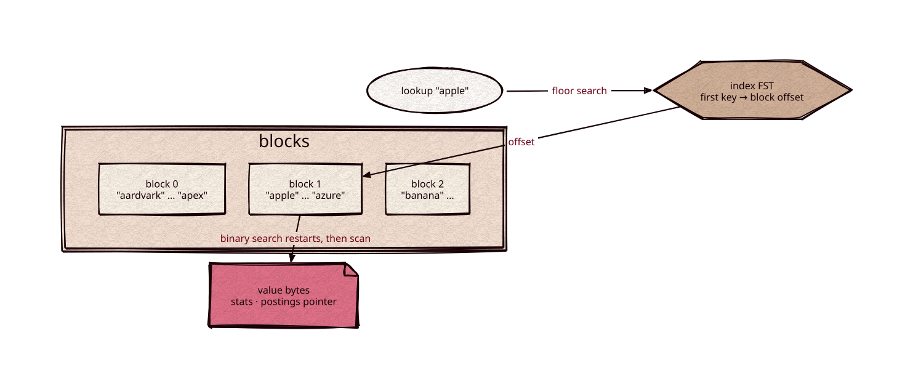

# termdict

[](https://github.com/Kronuz/termdict/actions/workflows/ci.yml)
[](LICENSE)


A block-tree sorted string table for C++20: sorted byte-string keys mapped to opaque
value bytes, stored as prefix-compressed blocks with a small FST over each block's
first key. It is the term dictionary of a search engine: keys are terms, values are
term statistics and postings pointers. Header-only; depends on
[fst](https://github.com/Kronuz/fst) and [varint](https://github.com/Kronuz/varint).



## ✨ Highlights

- `termdict::builder(alphabet)`: `add(key, value)` in strictly increasing key order;
  `finish()` returns two byte strings, the blocks and the index. `alphabet` names every
  byte the keys use (empty: all 256).
- Key suffixes are coded over the alphabet: each byte becomes its rank,
  `bit_width(size - 1)` bits wide, so codes sort as the bytes do. Lowercase terms take
  5 bits a byte. Each restart run stores its suffixes as one bit stream.
- `termdict::reader(blocks, index)`: `find(key)` returns the value bytes or nothing;
  `scan(from, f)` visits entries with keys `>= from` in order; `reader::cursor` pulls
  every entry in order, one block decoded at a time, for k-way merges of dictionaries,
  and `cursor::seek(from)` moves it to the first key `>= from` from any position.
- A seek starts at its target: one `fst::floor_value`, a binary search over the block's
  restart points, and one restart run walked without building keys; only the landing
  key is rebuilt, as the target's shared prefix plus its own suffix.
- Blocks hold 32–64 entries (cut at 64, or at 32 or more once 1 KiB is reached). Entries
  are prefix-compressed; every 32nd entry is a restart point stored whole.
- A lookup is one `fst::floor_value` over the block index, a binary search over at most
  two restart points, and at most 32 entry decodes that compare the target in place
  without rebuilding keys.
- Every length and offset read from a block is bounds-checked; a violation throws
  `termdict::corrupt`. The reader's constructor validates the alphabet and the whole FST
  index, one linear pass over its nodes (no hook needed), and throws `corrupt` on malformed
  bytes. The FST's values are block offsets; each is checked against the blocks when a
  lookup or seek opens that block.
- `reader(blocks, index, verify, context)` calls `verify(context, offset, length)`
  on each block's bytes before reading them (its length prefix, then the whole
  block), for checksum verification on first use; a false return throws `corrupt`.
  Without it, a lookup, seek or scan validates only the entries it decodes, so damage
  elsewhere in a block goes unnoticed until something reads it.

## 📦 Installation

Requires a C++20 compiler; CMake 3.14 or newer for the CMake route. CI builds it on
Linux (x86_64, arm64), macOS (arm64, x86_64), and FreeBSD, plus ASan, UBSan, and TSan
builds.

```cmake
include(FetchContent)
FetchContent_Declare(termdict
  GIT_REPOSITORY https://github.com/Kronuz/termdict.git
  GIT_TAG        main)
FetchContent_MakeAvailable(termdict)

target_link_libraries(my_app PRIVATE termdict::termdict)
```

## 🚀 Quick start

```cpp
#include "termdict.hh"

termdict::builder b("aelpy");           // the keys' bytes
b.add("apple", "\x01\x02");
b.add("apply", "\x03");
auto tables = b.finish();               // tables.blocks, tables.index

termdict::reader r(tables.blocks, tables.index);
auto v = r.find("apply");               // "\x03"
r.scan("app", [](std::string_view key, std::string_view value) { return true; });

termdict::reader::cursor c(r);
for (bool more = c.seek("applf"); more; more = c.next()) {
  // c.key(), c.value(): "apply" first
}
```

## ⚡ Performance

English Wikipedia vocabulary (3,964,752 terms), 6-byte values, Linux VM on an Intel
i9-9980HK, Clang 18 `-O3`, against Lucene 10.4's `TermsEnum.seekExact` on the same terms
in the same VM (`strata/bench/phase2/lucene_seek`). Absent keys are present keys with a
byte appended or the last byte changed.

| Lookup | termdict | Lucene `seekExact` | Full-vocabulary `fst::get` | Hash map |
|---|---:|---:|---:|---:|
| Present | 645 ns | 1,190 ns | 368 ns | 126 ns |
| Absent | 686 ns | 1,250 ns | 389 ns | 94 ns |

The tables take 12.35 bytes per key including the 6-byte values (blocks 48.0 MB, index
0.9 MB).

## 🛠️ Building and testing

```sh
cmake -S . -B build && cmake --build build && ctest --test-dir build
build/termdict_bench KEYS_FILE
```

The tests compare `find`, `scan`, and cursor seeks with `std::map` over random key sets
(including long values that force small blocks) and the system dictionary, seek to every
key and beside it across block boundaries, reject unsorted input and out-of-alphabet codes
at every width, query every truncation and 20,000 random corruptions of the blocks, reject each malformed-FST
case and every truncation and single-byte change of the index, and compare a golden fixture.
`fuzz/fuzz_reader.cc` and `fuzz/fuzz_open.cc` (arbitrary blocks and index bytes) are libFuzzer
targets. `build/termdict_scan_bench` times
sequential decode, seeks, and lookups on strata's KV keys and a vocabulary
([docs/perf/seek-decode.md](docs/perf/seek-decode.md)).

## 🎯 When to use it

- ✅ A sorted, immutable key-to-bytes table with ordered scans from any key.
- ❌ Mutable maps: build once, then read.

## 📚 Documentation

- [AGENTS.md](AGENTS.md): repository map and invariants.

## 🤝 Contributing

Issues and pull requests are welcome. Read [AGENTS.md](AGENTS.md) first. CI must
pass on every platform.

## 📄 License

MIT, Copyright (c) 2026 Germán Méndez Bravo. See [LICENSE](LICENSE).
