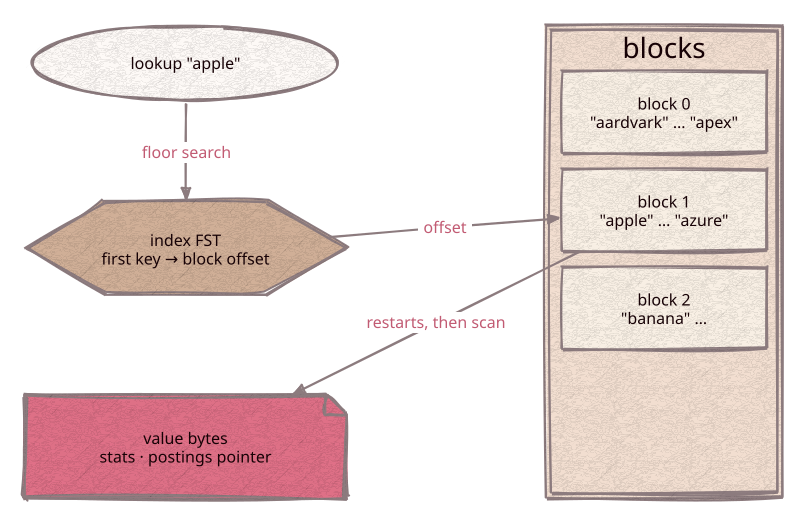

# termdict

Part of [Kronuz C++ Libraries](https://github.com/Kronuz/cpp-libraries), a collection of small, reusable C++ libraries.

[](https://github.com/Kronuz/termdict/actions/workflows/ci.yml)
[](LICENSE)


Block-tree sorted string table for C++20: prefix-compressed blocks indexed by an FST,
with in-place, bounds-checked lookups. It maps sorted byte-string keys to opaque value
bytes, and a small FST over the blocks' first keys finds the block a key lives in. It
is the term dictionary of a search engine: keys are terms, values are term statistics
and postings pointers.



## ✨ Highlights

- **Two flat byte strings.** `builder::finish()` returns the blocks and the index, and a
  `reader` opens them in place as `std::string_view`s.
- **Compact.** Blocks of 32 to 64 prefix-compressed entries, a restart every 32, and key
  suffixes coded in `bit_width(alphabet size - 1)` bits a byte (5 for lowercase terms):
  11.04 bytes per key on the 235,976 words of `/usr/share/dict/words`, 6-byte values included.
- **Lookups without rebuilding keys.** One `fst::floor_value` over the block index, a
  binary search over at most two restart points, and at most 32 entry decodes that
  compare the target in place.
- **Ordered scans and seeks.** `scan(from, f)` and `reader::cursor` visit entries in key
  order from any key, one block decoded at a time, for k-way merges of dictionaries.
- **Bounds-checked.** Every length and offset read from a block is checked, the
  constructor validates the whole FST index, and malformed bytes throw
  `termdict::corrupt`.
- **Checksums on first use.** An optional `verify(context, offset, length)` hook sees
  each block's bytes before the reader decodes them.

## 🚀 Quick start

```cpp
#include "termdict.hh"

#include <cstdio>
#include <string_view>

int main() {
	termdict::builder b("aelpy");          // every byte the keys use
	b.add("apple", "\x01\x02");            // keys in strictly increasing order
	b.add("apply", "\x03");
	auto tables = b.finish();              // tables.blocks, tables.index

	termdict::reader r(tables.blocks, tables.index);
	if (auto v = r.find("apply")) {
		std::printf("apply: %zu value byte\n", v->size());   // apply: 1 value byte
	}
	r.scan("app", [](std::string_view key, std::string_view) {
		std::printf("scan: %.*s\n", int(key.size()), key.data());   // scan: apple, scan: apply
		return true;
	});

	termdict::reader::cursor c(r);
	if (c.seek("applf")) {
		std::printf("seek: %.*s\n", int(c.key().size()), c.key().data());   // seek: apply
	}
}
```

## 📦 Installation

Requires a C++20 compiler and CMake 3.14 or newer. It brings
[fst](https://github.com/Kronuz/fst) and [varint](https://github.com/Kronuz/varint)
through FetchContent. CI builds and tests it with GCC and Clang on Linux (x86_64,
arm64), macOS (arm64, x86_64), and FreeBSD, plus ASan, UBSan, and TSan builds.

```cmake
include(FetchContent)
FetchContent_Declare(termdict
  GIT_REPOSITORY https://github.com/Kronuz/termdict.git
  GIT_TAG        dc42a4f8f45bfea1570d8a7d3f88d2b1a3156f55)  # or main, which tracks the tip
FetchContent_MakeAvailable(termdict)

target_link_libraries(my_app PRIVATE termdict::termdict)
```

Then `#include "termdict.hh"`.

## 🎯 When to use it

A sorted, immutable key-to-bytes table, built once and read many times, that needs
ordered scans or seeks from any key: term dictionaries, sorted string tables in
immutable segments.

Not for:

- **Mutable maps.** Build once, then read; keys go in strictly increasing order.
- **Point lookups alone.** A hash map answers a present key in 30 ns against 239 ns
  on the M4 Pro (see [Performance](#-performance)); termdict pays for order and size.
- **Trusting unverified blocks.** Without the `verify` hook, a lookup, seek, or scan
  checks only the entries it decodes, so damage elsewhere in a block goes unnoticed
  until something reads it.

## ⚡ Performance

`reader::find` on the 235,976 words of `/usr/share/dict/words` (the macOS word list, one key
per line), each with a 6-byte value, in nanoseconds per lookup: the median over batches of
1,024 lookups, then the median of six rounds (three runs of two). A `present` lookup finds a
key that is in the table; an `absent` one asks for a present key with a `q` appended or its
last byte's low bit flipped. The columns are the structures that answer the same lookup:

- **termdict**: `reader::find`.
- **`fst::get`**: one FST over the whole vocabulary, [fst](https://github.com/Kronuz/fst/tree/39245fa)
  at commit 39245fa, the one CMake pins.
- **Hash map**: the open-addressing table in `bench/bench.cc` (FNV-1a, linear probing, at
  most half full).
- **`std::unordered_map`** keyed by `std::string_view`, and **`std::binary_search`** over a
  sorted `std::vector<std::string>`: the standard library of Apple clang 17 (libc++).

Before it times anything the bench checks that every column finds every present key (with the
key's index as the value, for termdict and the FST) and none of the absent ones.

| Machine | Lookup | termdict | `fst::get` | Hash map | `std::unordered_map` | `std::binary_search` |
| --- | --- | ---: | ---: | ---: | ---: | ---: |
| Apple M4 Pro | present | 239 | 146 | 30 | 46 | 190 |
| Apple M4 Pro | absent | 248 | 154 | 34 | 33 | 193 |
| Intel Core i9-9980HK | present | 422 | 126 | 57 | 194 | 321 |
| Intel Core i9-9980HK | absent | 436 | 132 | 42 | 116 | 324 |

termdict is the slowest column on both machines: a lookup is one FST floor, a binary search over
at most two restart points and at most 32 in-place entry decodes, the price of ordered scans
and seeks in a small table. The tables take 11.04 bytes per key including the values (blocks 2,553,391
bytes, index 52,386), against 6.20 for the full-vocabulary FST (64-bit values) and 62.89 for
the hash map; the two standard containers were not sized.

Apple M4 Pro (macOS 26) and Intel Core i9-9980HK (macOS 15), Apple clang 17, `-O3 -DNDEBUG`
(CMake's Release), each with the machine to itself:

```sh
cmake -B build -DCMAKE_BUILD_TYPE=Release
cmake --build build --target termdict_bench
./build/termdict_bench /usr/share/dict/words   # two rounds a run; run it three times
```

[docs/perf/lookup.md](docs/perf/lookup.md) has the spread and the p50 and p99 of each column;
the seek and decode measurements are in the other notes of [docs/perf/](docs/perf/).

## 📚 Documentation

- [ARCHITECTURE.md](ARCHITECTURE.md): building, reading, seeking, and validation.
- [docs/perf/](docs/perf/): the lookup comparison, and the seek and decode measurements.
- [AGENTS.md](AGENTS.md): repository map, the byte layout, and invariants.
- [Catalog entry](https://github.com/Kronuz/cpp-libraries/blob/main/AGENTS.md#termdict).

## 🛠️ Building and testing

```sh
cmake -B build
cmake --build build
ctest --test-dir build
```

The tests compare `find`, `scan`, and cursor seeks with `std::map`, inject truncations
and random corruptions into the blocks and the index, and check a golden fixture.
`-DTERMDICT_FUZZ=ON` with Clang builds the libFuzzer targets; `termdict_bench`,
`termdict_scan_bench`, and `termdict_open_bench` build with the tests.

## 🤝 Contributing

Issues and pull requests are welcome. Read [AGENTS.md](AGENTS.md) first, and the
[catalog's AGENTS.md](https://github.com/Kronuz/cpp-libraries/blob/main/AGENTS.md) for
the family's rules. CI must pass on every platform.

## 📄 License

MIT; see [LICENSE](LICENSE).
